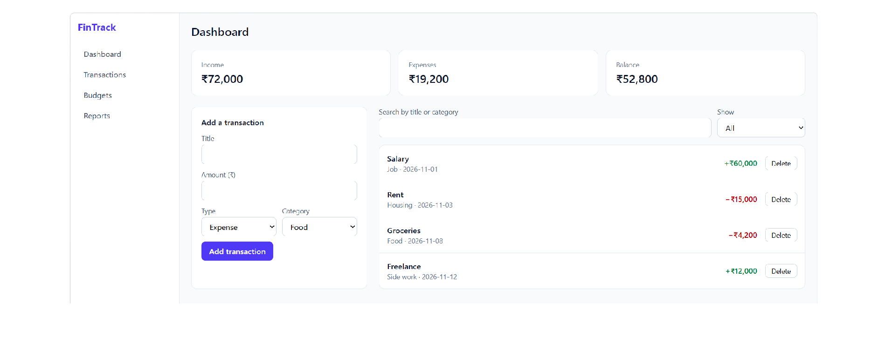

# FinTrack

A personal finance dashboard for tracking income and expenses.

**Status:** In progress. Frontend with local storage is complete; routing, charts and a backend are planned.

## Features

- Add income and expense transactions with validation
- Delete transactions
- Live totals for income, expenses and balance
- Search by title or category, and filter by type
- Data persists across page refreshes (browser localStorage)
- Responsive layout

## Tech stack

React 19.3.1, TypeScript 6.0.3, Vite 8.3.6, Tailwind CSS 4.3.5

## Run locally

    cd client
    npm install
    npm run dev

## What I learned

- Lifting state up and keeping derived data computed instead of stored
- Writing a reusable, generic custom hook (`useLocalStorage`)
- Building accessible forms with labels and validation messages

## Roadmap

- [ ] React Router with tab navigation
- [ ] Monthly spending chart and category breakdown
- [ ] Budget limits with warnings
- [ ] Node, Express and MongoDB backend with JWT login
- [ ] Tests and deployment
